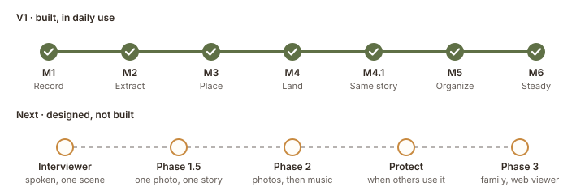
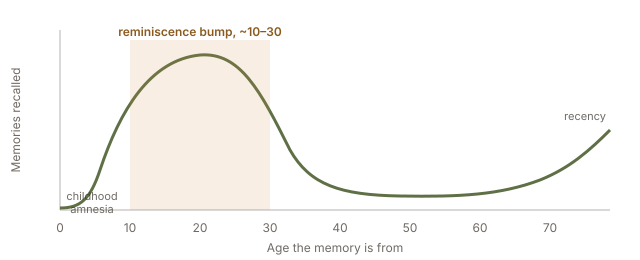
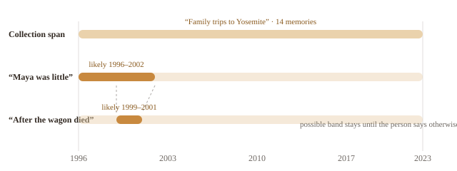
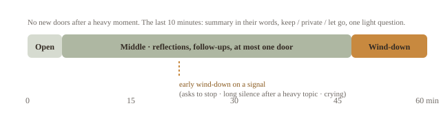
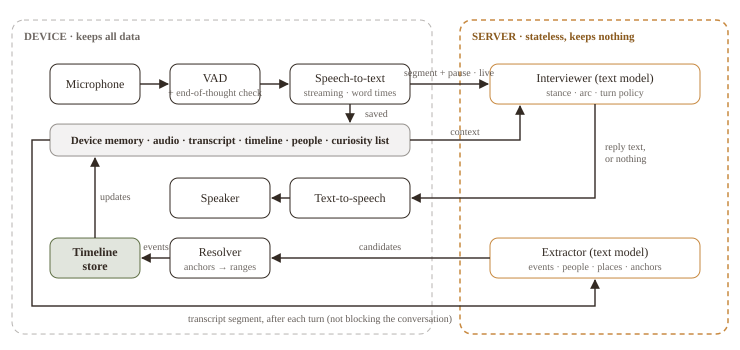
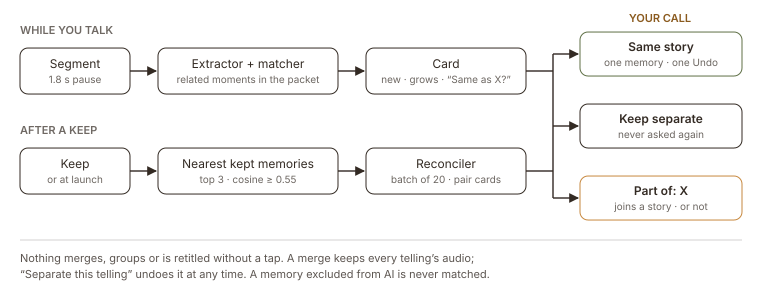
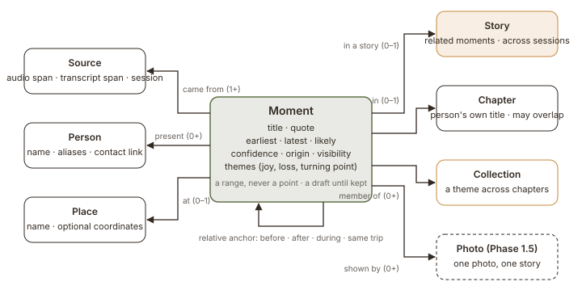

# Lifeline Overview

> Markdown copy of the overview page (live: https://claude.ai/artifact/DrXtBmNYMmqfnjRJhTYEDP), rewritten 2026-10-25 for V1 as built through M6. Figures are SVG files in `docs/figures/`. The "under the hood" section follows ASD-STE100 style.

## An app that listens to your life and keeps it.

You tell a story, a few minutes at a time. It is saved in your own voice the moment you speak, sorted while you get on with your day, and over weeks it grows into a timeline you can play back: chapters, stories, moments.

Status: V1 built (M1 to M6), in daily use on Jake’s iPhone · Updated October 26, 2026

**How to read this.** The first half (what we are building, what we are learning, and the glossary) is the product: about 10 minutes. The second half, “How it works under the hood”, is the engineering view and is optional.

## What we are building

Most journaling tools ask you to write. Most family-history tools ask you to fill in forms. Lifeline asks you to tell one story out loud, the way you would over lunch, and does the organizing itself, only when you agree to it. The intended rhythm is a few minutes a day, with the timeline growing over weeks rather than in one long sitting.

1. **Talk.** Choose “Tell a quick story” (one prompt, done when you are) or “Settle in” (more of a conversation: the next question arrives when the room goes quiet). One speaker. The screen can lock.
2. **Saved.** The audio and an on-device transcript are written as you speak. Finishing never waits for anything else.
3. **Sorted.** In the background, each completed thought goes to the extractor with the context it needs and comes back as possible memories.
4. **Kept.** Keep, change or dismiss a card whenever you like, or never. Nothing merges, groups or gets a title without your tap.
5. **Placed.** Kept moments land on a timeline as honest ranges (“during the Boston years”), inside stories and chapters, or on the shelf until a date turns up.

The result is three things at once: a **journal** for revisiting fond memories, an **autobiography** you can replay in your own voice, and, later, a **family record** where several people’s versions of the same Christmas sit side by side.

The shape changed on the way. The first design imagined 30 to 60 minute oral-history sittings with a spoken interviewer. Real use was a few minutes at a time, and a design review warned that cards, people, dates and session review stacked together would feel like maintaining a database. Both pushed the product toward a short daily practice in which keeping the story comes first and organizing it is optional.

*Where the project stands. The top row is built and in use; the bottom row is designed and waiting. Privacy controls beyond hide, exclude and delete were deferred while Jake was the only user; see the open questions.*

| Milestone | What it added |
| --- | --- |
| M1 Record | Screen-off recording, on-device transcription with word times, local storage, playback of any segment. |
| M2 Extract | Possible memories as cards; people resolved once with aliases; “who’s this?”; the `lifeline` command on a Mac. |
| M3 Place | The resolver: memories as ranges, collections, the shelf, relative questions, a fresh opening question each session. |
| M4 Land | Finishing never waits for sorting; the quiet Listen view and the review view; Keep / Change… / Dismiss with Undo; “Check this” tags; the light landing; the disclosure card; hide and exclude as two flags. |
| M4.1 Same story | On-device matching across recordings; “Same as X?” on a card; “Tell me when” for a stated date. |
| M5 Organize | A duplicate pass over kept memories; groups merge on one tap; a telling across a pause is one card; stories; a token-budgeted context packet. |
| M6 Steady | A visible, restartable sorting status; “Your copy” export and restore; trim a telling to the words that belong to it. |

## What we are learning

The design is grounded in four fields that have worked on the same problem for decades: oral history, therapy (narrative therapy, motivational interviewing, life review), autobiographical-memory research, and memoir craft. The nine principles below are the distilled version; every screen and every prompt is checked against them. The ninth came from the design review.

1. **The person is the author.** The app listens, reflects and organizes. It never interprets, evaluates or corrects a life.
2. **Ask for scenes, not facts.** Places, people and dates are harvested from stories, never requested as a form.
3. **Reflect more than you ask.** After any question, the next turns are reflections or silence. Never fill a pause.
4. **Follow the tangent, keep the thread.** Memory moves by association. Go where the person goes; file the dropped thread for later.
5. **Uncertainty is shown, never hidden.** Guesses look like guesses until confirmed. Nothing unsaid is filled in.
6. **Hard chapters are doors, not destinations.** Loss, illness and regret are offered once and left alone.
7. **Many true versions.** Family accounts of one event sit side by side. The app never adjudicates.
8. **Every session lands.** Sessions end deliberately and lightly, with the person’s say over what is kept.
9. **Preserve first, organize later.** The recording is kept the moment it is made. Cards approve organization, never survival.

### What real use taught us

Jake has used each milestone on his own phone. Most changes since the first design came from that, or from the review.

| What happened | What changed | Where |
| --- | --- | --- |
| Sessions ran a few minutes, not an hour. | Short is the default. A quick story has no clock on screen; settling in differs in shape, not length. The timer became a backstop, with no automatic stop before a 3-hour recording limit. | M4 |
| The review warned that the app could feel like homework. | Principle 9. Recording is the default view; review is optional and opened by choice; the landing says the recording is saved and offers “Done for now”. | M4 |
| “Not quite” dismissed a card that only needed fixing. | Keep / Change… / Dismiss with Undo. Keeping does not endorse the guesses, which carry “Check this”. Later: trim a telling to its own words. | M4, M6 |
| One story told on two days became two memories. | On-device matching finds related moments in every recording; the card asks “Same as X?”; one tap merges, Undo takes it back. | M4.1 |
| A memory with no anchor had no way to get a date. | “Tell me when”: a year, around a year, between two years, or an age, stored and shown as said. | M4.1 |
| Three tellings of one friendship sat side by side; a long telling split into three cards. | A duplicate pass asks a reconciler which kept memories are the same; groups merge on one tap; a telling across a pause grows one card; related moments form stories. | M5 |
| After a recording the timeline said nothing, and it looked as if half was lost. | One quiet line says what is still sorting, or why sorting stopped, with Try again. | M6 |
| The phone held the only copy of everything. | “Your copy”: one `.lifeline` file to export and restore, kept out of the cloud backup until the person shares it. | M6 |
| A wind-down mock-up followed a grief story with “something lighter” about the same person. | A neutral closing line after a heavy session; no organizational prompt during a heavy moment; the disclosure flag tells past narration from present danger. | Review, M4 |

### Why memories cluster where they do

Adults recall far more from roughly ages 10 to 30 than from any later decade, the reminiscence bump. The kind of cue matters too: smells reach the earliest memories, music peaks in the teens, and “tell me about an important moment” reaches later and wider than a cue word. So a thin middle-aged chapter is normal, not a gap to nag about, and the opening question is chosen for the era it should reach.

*Illustrative shape of autobiographical recall for an adult over 40 (not measured data). The timeline will be dense in a person’s teens and twenties; the app expects that.*

### Fuzzy time is the normal case

People rarely give dates. They say “the summer after I graduated” or “when Maya was little”. Every memory therefore carries a range, not a point: a wide possible band and a narrower likely band. A collection such as *Family trips to Yosemite* can span a whole life while each memory inside it keeps its own range. Ranges tighten through relative questions, never a demand for a date. On screen the precision follows the memory: “during the Boston years” in a list, “probably 2011 to 2013” in the detail, the bands only in the editor.

*“The bear at the campsite” narrows from a 27-year collection span to a 3-year likely range through two relative questions. The person can stop at any step, or state the year with “Tell me when”; a stated date is shown as said.*

### Chapters, stories, moments

A session is when you recorded. A moment is a scene you described, with its own audio; the same moment told twice becomes one moment with two tellings. A story connects related moments, often told across several sessions. A chapter is the wider life context, titled in the person’s words. Collections carry themes across chapters. Stories are built and show as groups on the timeline. The fuller navigation, a Photos-style zoom from life to chapter to story with “Listen at this level”, is designed and not yet built.

### People are resolved, not guessed

Every name mentioned becomes a pending “who’s this?” card. The person resolves it once, to someone already in the story, to someone new, or as “not a person”, and the link holds across every memory. That keeps two Sams apart and lets “my sister” and “Maya” be one person. In a heavy moment no such card appears.

### Every session lands

A quick story is one prompt and ends when the person is done. Settling in is a conversation with a planned length, a wrap-up offer and an explicit “Keep going”. Either way the app owns the landing and keeps it light. A heavy moment brings the same landing early.

*The two session shapes. Nobody is stopped for talking longer than planned; the only automatic landing is the 3-hour recording limit.*

### Words we use

These words have specific meanings in the app, the designs and the code.

| Word | What it means |
| --- | --- |
| Session | One recording: when you spoke. Not part of the story structure. |
| Quick story / Settle in | The two ways in. One prompt, done when you are; or a conversation where the next question comes when it goes quiet. |
| Memory (moment) | One scene the person kept. The code says memory; the designs often say moment. |
| Telling | One time a memory was told, with its own audio. The same memory told on two days is one memory with two tellings. |
| Story | Related memories grouped together, often told across several sessions. |
| Chapter | A wider stretch of life, titled in the person’s own words (“The Boston years”). |
| Collection | A theme that crosses chapters (“Family trips”). |
| Card | A suggestion from the app: a possible memory, “Who’s this?”, “Same as X?”, “Are these the same?”. Nothing changes until the person taps. |
| Sorting | The background work that turns a recording into cards. It never blocks finishing. |
| Check this | The label on any guessed detail (a year, a person) until the person settles it. |
| Shelf | Where a memory with no date and no collection waits. It counts just as much as a dated one. |
| Stated date | A date the person gave with “Tell me when”, shown exactly as said. The app never invents one. |

---

## How it works under the hood

Optional for product readers. This section follows Simplified Technical English (ASD-STE100): short sentences, one instruction per sentence, active voice, and “must” for requirements. It describes V1 as built.

### 1. System overview

The system has two parts. The first part is the iPhone app. The second part is the Anthropic Messages API. V1 has no server of its own.

The app does all work that keeps data. It records, transcribes, stores, matches, resolves and shows the timeline. The app sends text to the API for sorting. The app does not send audio.

The API does not keep data. It receives a transcript segment and a context packet. It returns structured output. The app stores the result on the phone.

All logic is in a Swift package, `LifelineKit`. The package compiles for iOS and macOS. The app target holds only views, view models and the composition root. A macOS command, `lifeline`, runs the same extraction and resolution code on an exported session.

*V1 data flow. Capture, storage, matching, resolution and the timeline run on the phone. Only text crosses to the API, which keeps nothing. When a server is needed, it is `LifelineKit` compiled as a Swift server behind the same extraction protocol.*

### 2. Capture and transcription

One audio tap feeds two consumers: an audio file writer and the on-device transcriber (`SpeechAnalyzer`, iOS 26). The file and the transcript share one clock. The store keeps each word with its start and end time in milliseconds.

Recording continues when the screen locks. An interruption or a route change pauses the segment. The person can pause and resume.

A segmenter ends a segment after 1.8 seconds of silence. A segment must contain at least 3 seconds of speech. A segment is a unit of capture, not a unit of story. One story can span several segments.

The voice session is a protocol. V1 ships `ListenOnlyVoiceSession`. Its `say`, `acknowledge` and `interrupt` commands do nothing. The spoken interviewer will replace it behind the same protocol.

### 3. Sorting

A sorting worker reads pending segments from the store. Finishing a session must not wait for the worker. The worker starts at launch, when the person saves a key, when the app returns to the foreground, and on Try again.

For each segment the worker builds a context packet. The packet holds the profile text, the people and their aliases, the chapters, related earlier moments, the pending cards of the session, and the stories. The packet has a ceiling of 6,000 tokens. When the packet is too large, the builder removes whole entries from the least relevant section first. It never removes the profile text.

The worker sends the segment and the packet to the extractor. The default model is `claude-opus-5-5` at low effort, with a strict JSON schema. The prompt is versioned (extractor v5). Each candidate records the prompt version. A new version adds candidates. It never edits a kept memory.

The API key is in the Keychain. It must never be in the build, the repository or a log. Without a key, the app saves recordings and the segments wait.

One line on the timeline shows the sorting status: moments still sorting, a duplicate check in progress, sorting stopped (with Try again), or a missing key.

### 4. Organizing

Organizing never happens without a tap.

On-device sentence embeddings (Apple NaturalLanguage) represent each kept memory by its title and quote. When a segment arrives, the matcher finds the nearest earlier memories (cosine 0.55 or more) and adds them to the packet as related. The extractor can say that the segment retells one or more of them. A match of 0.80 or more also shows “Same as X?” on the card. A memory excluded from AI is never embedded or suggested.

A segment that continues a pending card makes that card grow. Keep then writes one memory with several spans.

After each Keep, and at launch, a duplicate pass examines kept memories. For each memory it takes the three nearest. It sends up to 20 pairs in one batch to the reconciler (prompt v1). The reconciler returns “same moment”, “same story” or “different”. The app shows the first two as pair cards. It stores “different” and never asks again.

“Same story” merges the newer memory into the older one. Every telling keeps its audio span. One Undo reverses the merge. “Separate this telling” makes a merged telling its own memory again, at any time.

A story groups related memories. The extractor can propose membership (“Part of: X”) and a title. The person keeps or removes both.

*Two routes to the same decision. While you talk, the extractor and the matcher propose; after a Keep, the duplicate pass and the reconciler propose. Every route ends in a card, and only a tap changes anything.*

### 5. Placing

The extractor returns anchors. An anchor is a phrase with a relation: before, after, during, same year as, an age, or a stated date. The resolver changes anchors into ranges. The resolver is a pure function of the anchors and the confirmed ranges.

The resolver must never ask for a date. It can ask one relative question, a choice between things the person said. When an anchor refers to something not yet placed, the resolver makes a floating stand-in and a curiosity item with its payoff (“placing this would place 4 memories”).

“Tell me when” lets the person state a year, around a year, a range of years or an age. The app stores the value with origin “stated” and shows it as said. The app never makes up a date.

A memory with no range and no collection goes to the shelf. The shelf offers “Add a date” and “Add to a collection”.

### 6. Data model

The store is SQLite (GRDB). Audio files are next to it. All offsets are milliseconds from the start of the session file.

*A session is when the person spoke; a segment is a unit of capture; a candidate is raw extractor output and is never edited. A memory is what the person kept, with one or more tellings, each an audio span in some session. Stories, chapters and collections group memories. Embeddings and duplicate pairs support organizing.*

### 7. Session arc and safety

The stages are open, wind-down and ended. A quick story shows no clock. It ends when the person taps “Let’s leave it there”.

Settle in offers the next question after 6 seconds of quiet that follows a story. At the planned length (30 minutes) it offers a wrap-up and “Keep going”. It offers again every 10 minutes. The only automatic landing is the recording limit of 3 hours.

Three signals start an early landing: the person taps “Let’s leave it there”; the extractor flags that the person wants to stop; the extractor flags a serious disclosure. A disclosure flag has two kinds, past and present. On a disclosure the app shows one fixed card. The model never writes it. During a heavy moment the app shows no organizational prompt, including “who’s this?”.

The landing says that the recording is saved. It shows a few moments with play. “Done for now” is the default. Review can wait. “Hide today” and “Delete today’s recording” are one tap away. After a heavy session the closing line is neutral.

A memory has two privacy flags. “Hide from timeline” removes it from everyday browsing. “Exclude from AI processing” stops all future sorting, matching and context use; it cannot recall text that was already sent.

If the app stops during a session, the next launch opens the landing for that session.

### 8. Keeping a copy

“Your copy” in Settings exports one `.lifeline` file. The file holds the database, the audio, the pause log and a manifest. It must never hold the API key.

A restore first writes a safety copy of the data on the phone. Then it stages the copy and applies it at the next launch, before the database opens. A copy with a newer schema is refused. An older one migrates.

The app excludes every `.lifeline` file and the audio folder from the phone’s cloud backup. A copy leaves the phone only when the person shares the file.

### Designed, not built

- **The spoken interviewer.** Reflections, acknowledgements and rare questions, in a cascade (voice activity, speech-to-text, a text model, text-to-speech) behind the existing voice-session protocol. Its turn policy: about 1 second of silence starts a fast end-of-thought check; a complete thought gets a reply after a 1 to 2 second grace; an unfinished one gets a capped wait of 6 to 8 seconds and then only a soft acknowledgement. A realtime speech model can replace the cascade later.
- **Navigation by level.** Life, chapter, story and moment as one zoomable view in the manner of Photos, with a year scrubber on the edge and “Listen at this level” as a playlist in the person’s voice.
- **Protect, when others use the app.** A privacy screen with Share and a Local-only session chosen before recording; span-level deletion that keeps playback offsets; re-running a new extractor version from inside the app.
- **Phase 1.5: one photo, one story.** Pick a photo and tell its story. No clustering, no faces.
- **Phase 2: props.** Favorite photos as prompts and anchors (PhotoKit gives dates and places; people are tagged by hand; a face model only after an evaluation against those tags), then music from an era.
- **Phase 3: family.** Per-memory sharing, several perspectives on one event, questions for each other, and a read-only web viewer.

> **Next.** Run the recording study now that V1 exists: 5 to 8 people, ten minutes each, scored with the app’s evaluation command (protocol in `docs/experiments/recording-study.md`). Settle the open product questions below, starting with what a second user needs. Engineering meanwhile tunes the starting numbers (match thresholds, the packet budget, the segment pause) on real recordings. Then choose the next build: the spoken interviewer or the one-photo prompt.

### Open questions

- Does a gentle daily nudge belong in V1 at all, given that streaks and counters are ruled out?
- How much may the app write? Verbatim quotes assembled into stories, or prose it composes in the person’s style?
- Memory kinds and domains (a feeling, a goal, an event; relationships, health, travel): a later design, with the seam kept open.
- A second person is starting to use the app. Is “each person’s recordings stay on their own phone” enough for now, or must part of “protect” (sharing controls, Local-only, finer deletion) ship first?

Companion material: the [grounding principles](https://claude.ai/artifact/VUpLNWEM86y4UHSbCgTHhE) (also `docs/PRINCIPLES.md`), the [design canvas](https://claude.ai/artifact/6vReaCCBrkFqzSkMk6JfRN) (start with the “Review revisions” row, R1 to R9; sources in `docs/design/`), `docs/DECISIONS.md` (every decision, newest first), and `docs/specs/` and `docs/plans/` (one spec and one plan per milestone).
