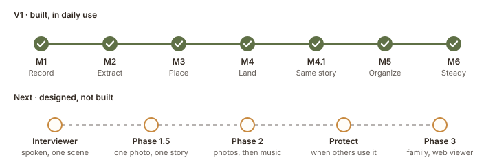
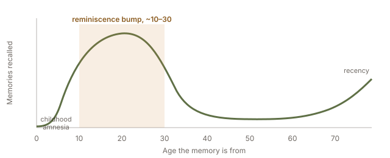
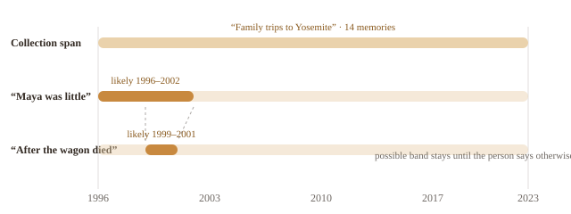
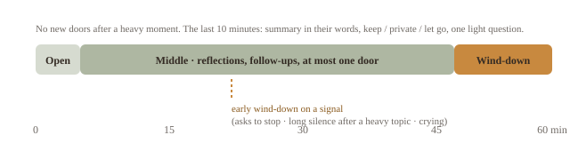
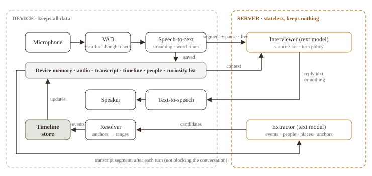
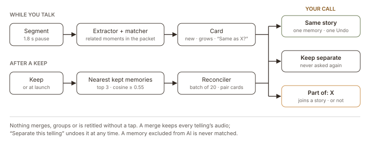
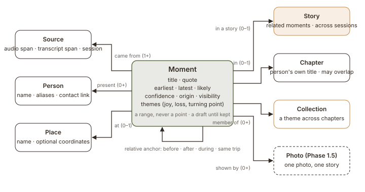

# Lifeline Overview

> Markdown copy of the overview page (live: https://claude.ai/artifact/DrXtBmNYMmqfnjRJhTYEDP). Regenerate it from the page rather than editing it by hand. Figures are SVG files in `docs/figures/`.

## An app that listens to your life and keeps it.

You tell a story, a few minutes at a time. It is saved in your own voice the moment you speak, sorted while you get on with your day, and over weeks it grows into a timeline you can play back: chapters, stories, moments.

Status: V1 built through M7, in daily use on Jake’s iPhone; M8, the spoken interviewer, in review · Updated October 26, 2026 (M7, M8)

**How to read this.** The first half (what we are building, what we are learning, and the glossary) is the product: about 10 minutes. The second half, “How it works under the hood”, is the engineering view and is optional.

## What we are building

Most journaling tools ask you to write. Most family-history tools ask you to fill in forms. Lifeline asks you to tell one story out loud, the way you would over lunch, and does the organizing itself, only when you agree to it. The intended rhythm is a few minutes a day, with the timeline growing over weeks rather than in one long sitting.

1. **Talk.** On first open, choose “Tell a quick story” (one prompt, done when you are) or “Settle in” (more of a conversation: the next question arrives when the room goes quiet). Later, tap the record bar for a quick story, or its menu for “Settle in”. One speaker. The screen can lock. With M8, the app can also speak a little: the opening, a short reflection now and then, and never over you.
2. **Saved.** The audio and an on-device transcript are written as you speak. Finishing never waits for anything else.
3. **Sorted.** In the background, each completed thought goes to the extractor with the context it needs and comes back as possible memories.
4. **Kept.** Keep, change or dismiss a card whenever you like, or never. Nothing merges, groups or gets a title without your tap.
5. **Placed.** Moments land on a timeline as honest ranges (“during the Boston years”), on one spine, in stories, or on the shelf until a date turns up. Things that are not moments (a first car, a grandmother, a belief) become details on pages for the people, places, things and ideas they are about.

**The shape of the app.** The app opens on five tabs: Timeline, People, Places, Things and You. A record bar sits above the tab bar on every tab. Its label names the page: “Tell a story”, “Tell a story about Maya” or “Tell a story about yourself”. Tap the bar to start a quick story. Its menu holds “Settle in” and “Tell a story about a photo”. A session started from a page records that page as its subject and opens with a question about it. Sessions is a labeled button on Timeline. Settings is a labeled button on You, and You is a portrait of the person in their own words (see “You as a portrait”). “Names you mentioned” is in the overflow menu on People. People is a grid of tiles. A tile shows the person’s key photo, or a letter when there is no photo. Each tile shows the name and the person’s own words, such as “my sister”. A labeled row above the grid sorts it: “Most told”, “First in your story” or “By name”. The sort starts on “Most told” at each launch. The pages for people, places and things open from their tabs. A page, a memory and You can each hold photos (see “Photos”). A photo can also start a story (see “A photo starts a story”).

The result is three things at once: a **journal** for revisiting fond memories, an **autobiography** you can replay in your own voice, and, later, a **family record** where several people’s versions of the same Christmas sit side by side.

The shape changed on the way. The first design imagined 30 to 60 minute oral-history sittings led by a spoken interviewer. Real use was a few minutes at a time, and a design review warned that cards, people, dates and session review stacked together would feel like maintaining a database. Both pushed the product toward a short daily practice in which keeping the story comes first and organizing it is optional. The interviewer is now coming back (M8), in a much quieter form: it reflects more than it asks, never fills a pause, and stops the moment you speak.

*Where the project stands. The top row is built and in use. In the bottom row, M8 is in review as three pull requests; the rest is designed and waiting. Privacy controls beyond hide, exclude and delete were deferred while Jake was the only user; see the open questions.*

| Milestone | What it added |
| --- | --- |
| M1 Record | Screen-off recording, on-device transcription with word times, local storage, playback of any segment. |
| M2 Extract | Possible memories as cards; people resolved once with aliases; “who’s this?”; the `lifeline` command on a Mac. |
| M3 Place | The resolver: memories as ranges, collections, the shelf, relative questions, a fresh opening question each session. |
| M4 Land | Finishing never waits for sorting; the quiet Listen view and the review view; Keep / Change… / Dismiss with Undo; “Check this” tags; the light landing; the disclosure card; hide and exclude as two flags. |
| M4.1 Same story | On-device matching across recordings; “Same as X?” on a card; “Tell me when” for a stated date. |
| M5 Organize | A duplicate pass over kept memories; groups merge on one tap; a telling across a pause is one card; stories; a token-budgeted context packet. |
| M6 Steady | A visible, restartable sorting status; “Your copy” export and restore; trim a telling to the words that belong to it. |
| M7 Kinds and entities | Facts, feelings and goals leave the timeline. People, Places, Things and Ideas get pages; standing statements become their details; “About you”; free-text domain tags; extractor v6. |
| M8 Interviewer *(in review)* | Three stacked PRs: the interviewer’s turns, recorded but silent; the fixed lines spoken on the phone with barge-in and “Quiet”; short model reflections behind a safety gate. A fourth step is the device run. |

## What we are learning

The design is grounded in four fields that have worked on the same problem for decades: oral history, therapy (narrative therapy, motivational interviewing, life review), autobiographical-memory research, and memoir craft. The nine principles below are the distilled version; every screen and every prompt is checked against them. The ninth came from the design review.

1. **The person is the author.** The app listens, reflects and organizes. It never interprets, evaluates or corrects a life.
2. **Ask for scenes, not facts.** Places, people and dates are harvested from stories, never requested as a form.
3. **Reflect more than you ask.** After any question, the next turns are reflections or silence. Never fill a pause.
4. **Follow the tangent, keep the thread.** Memory moves by association. Go where the person goes; file the dropped thread for later.
5. **Uncertainty is shown, never hidden.** Guesses look like guesses until confirmed. Nothing unsaid is filled in.
6. **Hard chapters are doors, not destinations.** Loss, illness and regret are offered once and left alone.
7. **Many true versions.** Family accounts of one event sit side by side. The app never adjudicates.
8. **Every session lands.** Sessions end deliberately and lightly, with the person’s say over what is kept.
9. **Preserve first, organize later.** The recording is kept the moment it is made. Cards approve organization, never survival.

### What real use taught us

Jake has used each milestone on his own phone. Most changes since the first design came from that, or from the review.

| What happened | What changed | Where |
| --- | --- | --- |
| Sessions ran a few minutes, not an hour. | Short is the default. A quick story has no clock on screen; settling in differs in shape, not length. The timer became a backstop, with no automatic stop before a 3-hour recording limit. | M4 |
| The review warned that the app could feel like homework. | Principle 9. Recording is the default view; review is optional and opened by choice; the landing says the recording is saved and offers “Done for now”. | M4 |
| “Not quite” dismissed a card that only needed fixing. | Keep / Change… / Dismiss with Undo. Keeping does not endorse the guesses, which carry “Check this”. Later: trim a telling to its own words. | M4, M6 |
| One story told on two days became two memories. | On-device matching finds related moments in every recording; the card asks “Same as X?”; one tap merges, Undo takes it back. | M4.1 |
| A memory with no anchor had no way to get a date. | “Tell me when”: a year, around a year, between two years, or an age, stored and shown as said. | M4.1 |
| Three tellings of one friendship sat side by side; a long telling split into three cards. | A duplicate pass asks a reconciler which kept memories are the same; groups merge on one tap; a telling across a pause grows one card; related moments form stories. | M5 |
| After a recording the timeline said nothing, and it looked as if half was lost. | One quiet line says what is still sorting, or why sorting stopped, with Try again. | M6 |
| The phone held the only copy of everything. | “Your copy”: one `.lifeline` file to export and restore, kept out of the cloud backup until the person shares it. | M6 |
| Much of what Jake said was not a moment: a wall in his room, a first car, a belief. On the timeline these filled the shelf and drew “when?” questions. | Memories have kinds. Facts, feelings and goals leave the timeline and attach to the person, place, thing or idea they are about, each with a page. The app never asks for a date on a thing or a place. An idea’s title is the person’s own words. | M7 |
| The app gave nothing back while Jake talked. | The app speaks briefly: one opening, an occasional reflection in Settle in, the fixed lines. Any speech stops it; “shh” or one tap makes it quiet; its words never enter the person’s transcript. | M8 (in review) |
| A wind-down mock-up followed a grief story with “something lighter” about the same person. | A neutral closing line after a heavy session; no organizational prompt during a heavy moment; the disclosure flag tells past narration from present danger. | Review, M4 |

### Why memories cluster where they do

Adults recall far more from roughly ages 10 to 30 than from any later decade, the reminiscence bump. The kind of cue matters too: smells reach the earliest memories, music peaks in the teens, and “tell me about an important moment” reaches later and wider than a cue word. So a thin middle-aged chapter is normal, not a gap to nag about, and the opening question is chosen for the era it should reach.

*Illustrative shape of autobiographical recall for an adult over 40 (not measured data). The timeline will be dense in a person’s teens and twenties; the app expects that.*

### Fuzzy time is the normal case

People rarely give dates. They say “the summer after I graduated” or “when Maya was little”. Every memory therefore carries a range, not a point: a wide possible band and a narrower likely band. A collection such as *Family trips to Yosemite* can span a whole life while each memory inside it keeps its own range. Ranges tighten through relative questions, never a demand for a date. On screen the precision follows the memory: “during the Boston years” in a list, “probably 2011 to 2013” in the detail, the bands only in the editor.

*“The bear at the campsite” narrows from a 27-year collection span to a 3-year likely range through two relative questions. The person can stop at any step, or state the year with “Tell me when”; a stated date is shown as said.*

### Chapters, stories, moments

A session is when you recorded. A moment is a scene you described, with its own audio; the same moment told twice becomes one moment with two tellings. A story connects related moments, often told across several sessions. A chapter is the wider life context, titled in the person’s words. Collections carry themes across chapters. Stories are built and show as groups on the timeline. A chapter is not a section of the Timeline: a moment that the person put in a named chapter shows the chapter as a tag. The tag is a button. It opens the chapter's sheet, where the person renames the chapter, says when it was, or removes it. Removing a chapter never removes a memory. The fuller navigation, a Photos-style zoom from life to chapter to story with “Listen at this level”, is designed and not yet built.

The Timeline is one spine of moments. Each moment has a mark on the spine. A ring with a solid line is a date the person stated. A ring with a dashed line is a guess or an “around” date. A dashed capsule is a span of more than one year. The years show in the margin. A gap follows the years between moments. From three years, the spine turns dashed and shows an “{n} years” label. A waypoint names the age period that starts at a moment, such as “Teens · by your age”, or the decade when the person has no birth date. There are no chapter sections and no year axis. The life map shows every chapter as a bar on a year axis. A chapter with no stated years shows under “Not placed in time yet”, with “Say when”. Until the pinned card exists (S6b), the life map opens from the Timeline’s “…” menu, item “Chapters”. A moment with no date goes to the shelf.

### Not everything is a moment

Much of a life story is not an event at a time: the house with the blue door, a grandmother who was Portuguese, a belief about hard work. These are kept as details of an entity, one of four kinds: People, Places, Things and Ideas. Each entity has a page. The page shows, from top to bottom: the type, the title, the person’s own words, a span only when the person gave dates, and Play. Then it shows the life strip, “What you’ve said about them”, “Often with”, the moments in date order, and Tags. A section with nothing in it does not show. A page with nothing told shows one line: “Stories you tell about {title} will show here.” An idea keeps its moments in order, so “I used to think X” and “now I think Y” sit together, and the app never judges the change. Statements about the person themself show on You, in the parts described under “You as a portrait”. Nothing is reclassified without a tap.

### People are matched, and every guess shows

Keep matches each said name to a person with seven rules. `PersonGuess` runs them in order, and the first rule that applies decides.

1. The said name and the said relation phrase ("Danielle, my sister") are both held by one person.
2. A relation phrase alone ("my mom") is held by one person.
3. A fuller name of two or more words equals one candidate's full name.
4. A person on file fits. With several, the most recently linked one wins.
5. Exactly one contact fits and no person does.
6. Two or more contacts fit and no person does.
7. Nothing fits. Keep makes a new person.

Each link between a memory and a person stores an origin: `assumed`, `said`, `confirmed` or `new`. A link made before this change has no origin. Rules 1 and 2 give `said`. Rules 3 to 5 give `assumed`. Rules 6 and 7 give `new`. A choice the person made gives `confirmed`.

An `assumed` link shows a dashed outline and the word "Assumed" until the person settles it with "Done" or changes it. A guess teaches the app no name. The app saves an alias only from the person's own words or choice. An older link shows no mark until a later retelling or a merge reaches it. Then it takes the guess's origin, and shows the mark when that is `assumed`. Keep never weakens an origin.

A person chip on a card, on the landing, on the memory page and on the person's page opens the "Who is this?" sheet. A name marked "Not a person" on a card that waits keeps a quiet chip, so the sheet opens again before Keep. A change can move all the moments of one recording, with the checkbox on, or one moment. A change shows "Changed to {name}." with Undo for 6 seconds. One answer carries inside one recording only. A name no memory carries keeps the old "Who's this?" card with its four choices.

### People and contacts

A person can hold one contact, and a contact one person. A person needs no contact.

- **What the app reads.** The app reads the name fields, the nickname and the picture of a contact. The name fields include the organization name, because a company contact is named by it. It reads nothing else. Rules 3, 5 and 6 match against a cache of the contacts the app can see.
- **What the app keeps.** For a linked person the app keeps the contact's identifier, the contact's name and a copy of the picture. The copy goes through the photo store, as any photo does. It keeps no other contact. A name the owner said or typed is never replaced by a contact's name.
- **What goes to the model.** Nothing from a contact goes to the model. A person made from a contact goes to the model under the name the owner said, never under the contact's name. A person with no said name is left out.
- **When the app asks for access.** The app asks once, never at first launch. It asks on the landing of the first recording with a kept person, when the landing is quiet: the recording was not heavy, no serious disclosure showed and sorting is done. It also asks when the owner taps "Link to a contact" or "Search your contacts". After a yes on the landing, the app looks again at that recording only.
- **The check.** The app checks the linked contacts at launch and when the system says contacts changed. A rename of the contact changes the kept name. It changes the person's name only when the name came from the contact. With no access, the check does nothing. A linked person with no copy of the picture gets the copy. A picture with the same bytes as a stored photo changes nothing. A new picture replaces the app's own copy, and only while that copy is the person's first photo. A copy that the owner removed does not come back. A contact that is gone unlinks nothing: the person keeps everything and shows "This contact is not in your contacts now". Under full access, one exact free name match links the person again. Under limited access the app cannot tell a deleted contact from one it may not see. A contact that is not shared shows as missing, and the app never links again by name.
- **Suggestions.** When one free contact fits the name of a person with no contact, the person's page asks "Is this the same person?". The suggestion shows on the person's page only. "No" is kept.
- **With limited access.** The app matches against the shared contacts. The search shows a button that shares one more contact.
- **With no access.** The app matches against people on file only, and every guess is still marked. A person with a contact shows "Allow contacts" when the app never asked, and "Allow contacts in Settings" when access is denied. A person with no contact shows the card "Allow contacts in Settings" when access is denied.

### Every session lands

A quick story is one prompt and ends when the person is done. Settling in is a conversation with a planned length, a wrap-up offer and an explicit “Keep going”. Either way the app owns the landing and keeps it light. A heavy moment brings the same landing early.

*The two session shapes. Nobody is stopped for talking longer than planned; the only automatic landing is the 3-hour recording limit.*

### Words we use

These words have specific meanings in the app, the designs and the code.

| Word | What it means |
| --- | --- |
| Session | One recording: when you spoke. Not part of the story structure. |
| Quick story / Settle in | The two ways in. One prompt, done when you are; or a conversation where the next question comes when it goes quiet. |
| Memory (moment) | One scene the person kept. The code says memory; the designs often say moment. |
| Telling | One time a memory was told, with its own audio. The same memory told on two days is one memory with two tellings. |
| Story | Related memories grouped together, often told across several sessions. |
| Chapter | A wider stretch of life, titled in the person’s own words (“The Boston years”). |
| Collection | A theme that crosses chapters (“Family trips”). |
| Card | A suggestion from the app: a possible memory, “Who’s this?”, “Same as X?”, “Are these the same?”. Nothing changes until the person taps. |
| Sorting | The background work that turns a recording into cards. It never blocks finishing. |
| Check this | The label on any guessed detail (a year, a person) until the person settles it. |
| Shelf | Where a memory with no date and no collection waits. It counts just as much as a dated one. |
| Kind | What a memory is: a moment (an event, or other), or a fact, feeling or goal. Only moments go on the timeline. |
| Entity | A person, place, thing or idea with a page of its own. |
| Detail | A standing statement attached to an entity (“the house had a blue door”). The details about the person show on You, under “Who you are”. |
| Turn | Something the app says out loud (M8). Stored apart from the person’s words, never made into a memory. |
| Stated date | A date the person gave with “Tell me when”, shown exactly as said. The app never invents one. |

---

## How it works under the hood

Optional for product readers. This section follows Simplified Technical English (ASD-STE100): short sentences, one instruction per sentence, active voice, and “must” for requirements. It describes V1 as built through M7, and M8 as it stands in review.

### 1. System overview

The system has two parts. The first part is the iPhone app. The second part is the Anthropic Messages API. V1 has no server of its own. The extractor and the reconciler use `claude-opus-5-5`. The M8 interviewer uses `claude-haiku-5-5` for speed.

The app does all work that keeps data. It records, transcribes, stores, matches, resolves and shows the timeline. The app sends text to the API for sorting. The app does not send audio.

The API does not keep data. It receives a transcript segment and a context packet. It returns structured output. The app stores the result on the phone.

All logic is in a Swift package, `LifelineKit`. The package compiles for iOS and macOS. The app target holds only views, view models and the composition root. A macOS command, `lifeline`, runs the same extraction and resolution code on an exported session.

*V1 data flow. Capture, storage, matching, resolution and the timeline run on the phone. Only text crosses to the API, which keeps nothing. When a server is needed, it is `LifelineKit` compiled as a Swift server behind the same extraction protocol.*

### 2. Capture and transcription

One audio tap feeds two consumers: an audio file writer and the on-device transcriber (`SpeechAnalyzer`, iOS 26). The file and the transcript share one clock. The store keeps each word with its start and end time in milliseconds.

Recording continues when the screen locks. An interruption or a route change pauses the segment. The person can pause and resume.

A segmenter ends a segment after 1.8 seconds of silence. A segment must contain at least 3 seconds of speech. A segment is a unit of capture, not a unit of story. One story can span several segments.

The voice session is a protocol. On `main`, the app ships `ListenOnlyVoiceSession`; its `say`, `acknowledge` and `interrupt` commands do nothing. M8 renames it `CascadeVoiceSession` and makes the commands real behind the same protocol (section 10).

### 3. Sorting

A sorting worker reads pending segments from the store. Finishing a session must not wait for the worker. The worker starts at launch, when the person saves a key, when the app returns to the foreground, and on Try again.

For each segment the worker builds a context packet. The packet holds the profile text, the people and their aliases, the chapters, related earlier moments, the pending cards of the session, and the stories. The packet has a ceiling of 6,000 tokens. When the packet is too large, the builder removes whole entries from the least relevant section first. It never removes the profile text.

The worker sends the segment and the packet to the extractor. The default model is `claude-opus-5-5` at low effort, with a strict JSON schema. The prompt is versioned (extractor v6). Each candidate records the prompt version. A new version adds candidates. It never edits a kept memory.

The API key is in the Keychain. It must never be in the build, the repository or a log. Without a key, the app saves recordings and the segments wait.

One line on the timeline shows the sorting status: moments still sorting, a duplicate check in progress, sorting stopped (with Try again), or a missing key.

### 4. Organizing

Organizing never happens without a tap.

On-device sentence embeddings (Apple NaturalLanguage) represent each kept memory by its title and quote. When a segment arrives, the matcher finds the nearest earlier memories (cosine 0.55 or more) and adds them to the packet as related. The extractor can say that the segment retells one or more of them. A match of 0.80 or more also shows “Same as X?” on the card. A memory excluded from AI is never embedded or suggested.

A segment that continues a pending card makes that card grow. Keep then writes one memory with several spans.

After each Keep, and at launch, a duplicate pass examines kept memories. For each memory it takes the three nearest. It sends up to 20 pairs in one batch to the reconciler (prompt v1). The reconciler returns “same moment”, “same story” or “different”. The app shows the first two as pair cards. It stores “different” and never asks again.

“Same story” merges the newer memory into the older one. Every telling keeps its audio span. One Undo reverses the merge. “Separate this telling” makes a merged telling its own memory again, at any time.

A story groups related memories. The extractor can propose membership (“Part of: X”) and a title. The person keeps or removes both.

*Two routes to the same decision. While you talk, the extractor and the matcher propose; after a Keep, the duplicate pass and the reconciler propose. Every route ends in a card, and only a tap changes anything.*

### 5. Placing

The extractor returns anchors. An anchor is a phrase with a relation: before, after, during, same year as, an age, or a stated date. The resolver changes anchors into ranges. The resolver is a pure function of the anchors and the confirmed ranges.

The resolver must never ask for a date. It can ask one relative question, a choice between things the person said. When an anchor refers to something not yet placed, the resolver makes a floating stand-in and a curiosity item with its payoff (“placing this would place 4 memories”).

“Tell me when” lets the person state a year, around a year, a range of years or an age. The app stores the value with origin “stated” and shows it as said. The app never makes up a date.

A memory with no range and no collection goes to the shelf. The shelf offers “Add a date” and “Add to a collection”.

### You as a portrait

The You tab shows the person, in their own words and voice. From top to bottom it shows these parts.

- **Header.** The name and a birth line, both from what the person typed: “born 1990 in Dayton”, “born 1990” or “born in Dayton”. With no name, no name shows.
- **Life strip.** The owner’s own strip. It opens the owner’s own page. With no moments linked to the owner, no strip shows.
- **Lead line.** One line of the person’s own words in large type, with “Hear yourself say it, 0:04”. The app picks it from facts, feelings and goals that have own words and a recording. It picks a new one each time You appears, and it keeps the same one across a refresh. The lead never repeats in its own part. A tag chip other than “All” does not change it. A line first told in a heavy session (a disclosure, or a wish to stop) never leads. It still shows in its part, with its play control.
- **Four parts.** “Who you are” holds facts, with tag chips (“All” and the person’s tags). “How it felt” holds feelings. Each feeling may say “about {title}”, and the line opens that page. “What you think” holds ideas. “What you’re hoping for” holds goals. Each goal says “said in {month}”, the month its session started. The year shows only when it is not this year: “said in {month} {year}”. A part with nothing in it does not show.

Quotation marks go only around the person’s own words. A title that stands in shows without marks. Every line with a recording has a play control. It plays only the part of the recording where the person said that line. One line plays at a time. Playback stops when its line leaves the page: Hide, Delete, or a tag chip that filters it out. Hide and Delete… are on a long-press menu on each line. Hide shows “Hidden.” with Undo for 6 seconds. Delete asks first. “Hidden.” with Undo, a play error, and a failed hide, delete or undo show in one slot. The slot is pinned at the bottom of You, above the record bar, so it is on screen wherever the line was. One message shows at a time, and a newer one replaces the older. A play tap clears only an old error. It never ends Undo. VoiceOver announces each message when it appears. The slot clears when You disappears and when a new lead is picked.

A fact shows under “Who you are” when it has a detail link to the owner, or no detail link. A fact detailed only to someone else shows on that page. A fact about only a hidden person or thing follows it and does not show on You. The app never names a hidden entity in “about”. A You page with nothing told shows the header and “Stories you tell about yourself will show here.”

The About list left the Timeline. The Timeline summary still says “and N things about your life”, so a person who told only facts does not see the empty state. N counts the visible facts, feelings and goals. The tag filter and “Show hidden memories” do not change N. While a tag filter is on, the summary leaves out that part, and the tag menu offers only the tags that a moment carries.

Limits. Real playback is checked only on the iPhone, because test seeds have no audio. A line hidden from You has no way back after its 6-second Undo, or after the person leaves the You root. No screen shows a hidden fact, feeling or goal again. “Show hidden memories” on Timeline shows hidden moments only, not hidden facts, feelings or goals. A hidden fact, feeling or goal cannot be deleted, because no screen shows it. Lines hidden before this change are in the same state. Most facts about other people stay on You until extractor v7 re-reads the archive and adds detail links. There is no dark palette yet.

### 6. Kinds and entities

Each memory has a kind: `event`, `other`, `fact`, `feeling` or `goal`. Events and other are moments. The timeline shows moments only. The resolver still stores a range for a fact, a feeling or a goal, but the timeline hides it, and the app never asks “when?” about it. The person changes a kind on the Change sheet (“What is this?”). The app never changes a kind without a tap.

An entity is a person, a place, a thing or an idea. One table holds all four. One link table connects memories to entities, with the relation “detail” or “mention”. A person keeps one extra record for what only a person has: the owner flag and a birth date. Every entity comes from something the person said and has a span that plays.

The extractor (v6) names entities in each memory. A named entity that is on file links to the memory. Otherwise the app matches by type and normalized title, or makes a new one. An idea’s title must be at most 8 consecutive words the person said. If no such quote exists, the title is “An idea you mentioned on {date}”. The app never asks for a date on a place or a thing. The person can add one.

A page shows the life strip below Play. The strip is an axis from the birth year to now, with one mark for each moment. A mark for a guessed date is hollow. Under the axis, one sentence says the same in words, such as “In 4 moments, from 1999 to 2003”. A guess reads “around” or “between”. A person with no told moments has no strip.

“Often with” lists the other entities that share two or more told moments with this one. Each chip shows a count. A chip opens that entity’s page. The list never shows the owner. It creates no link. It shows only what the person told.

A quote on a list or a page hides filler words. It removes “um”, “uh” and “erm”. It removes “like” only between two commas. It removes “you know” when a comma follows it, or when it ends the quote after a comma. A word said twice in a row shows once, except “had had” and “that that”. A guessed date reads “around”, “between” or “about”. The memory page and the audio keep every word. The stored text never changes.

Domains (home, family, work, travel, and anything else the person says) are free-text tags on any element. There is no fixed list.

### 7. Data model

The store is SQLite (GRDB). Audio files are next to it. All offsets are milliseconds from the start of the session file.

*A session is when the person spoke; a segment is a unit of capture; a candidate is raw extractor output and is never edited. A memory is what the person kept, with a kind and one or more tellings, each an audio span in some session. A memory links to entities as a detail (“the house had a blue door”) or a mention. Stories, chapters and collections group moments.*

A chapter row holds a name and a stored range. The stored range holds stated years only: the person said them, or confirmed them. A range with another origin counts as no stated years. A moment has one tag, `memory.chapter_id`. The tag is what the person said. The resolver computes the span of a chapter's said members on each run, to place a moment that is anchored to the chapter (“during the Boston years”). The resolver never writes that span to the chapter, and no screen shows it as the chapter’s dates. A date inside a chapter’s years does not tag a moment.

A `photo` row holds one stored photo: its file name, its pixel size, when it was added, and what the file said about itself (a date taken, a place, and where each came from). A `photo_link` row puts a photo on one subject, which is an entity or a memory. Each link has a role (cover or attached) and a sort order. A link has exactly one of `entity_id` and `memory_id`. Deleting the photo, the entity or the memory deletes the link. A link has an origin (`photo_link.origin`): `story` for a link a photo story made, null for every other link. A `photo_page_declined` row records one photo that the person took off one entity's page. Its primary key is both columns, `photo_id` and `entity_id`. Deleting the photo or the entity deletes the row. `session.photo_pages_done` is true when the person tapped “Done” under the chips of the story's photo card. It is false (open) for a new story and for every story from before `v16`.

### 8. Session arc and safety

The stages are open, wind-down and ended. A quick story shows no clock. It ends when the person taps “Let’s leave it there”.

Settle in offers the next question after 6 seconds of quiet that follows a story. At the planned length (30 minutes) it offers a wrap-up and “Keep going”. It offers again every 10 minutes. The only automatic landing is the recording limit of 3 hours.

Three signals start an early landing: the person taps “Let’s leave it there”; the extractor flags that the person wants to stop; the extractor flags a serious disclosure. A disclosure flag has two kinds, past and present. On a disclosure the app shows one fixed card. The model never writes it. During a heavy moment the app shows no organizational prompt, including “who’s this?”.

The landing says that the recording is saved. It shows a few moments with play. “Done for now” is the default. Review can wait. “Hide today” and “Delete today’s recording” are one tap away. After a heavy session the closing line is neutral.

A memory has two privacy flags. “Hide from timeline” removes it from everyday browsing. “Exclude from AI processing” stops all future sorting, matching and context use; it cannot recall text that was already sent.

If the app stops during a session, the next launch opens the landing for that session.

### 9. Keeping a copy

“Your copy” in Settings exports one `.lifeline` file. The file holds the database, the audio, the pause log and a manifest. It must never hold the API key.

A restore first writes a safety copy of the data on the phone. Then it stages the copy and applies it at the next launch, before the database opens. A copy with a newer schema is refused. An older one migrates.

The copy also holds the photo files, in `photos/`, stored without compression. The manifest counts them. A copy made before photos existed restores with no photos. A build from before photos refuses a copy made after, because the schema is newer.

The app excludes every `.lifeline` file and the audio folder and the photos folder from the phone’s cloud backup. A copy leaves the phone only when the person shares the file.

### Photos

The person adds photos with the system picker, from “Add a photo” in the “…” menu of a person, place or thing page, a memory page, or You. “Add a photo” asks for no photo-library permission and makes no network call for a photo. Only “Tell a story about a photo” asks for access (see “A photo starts a story”).

One visit to the picker gives up to 20 photos. The app adds them one after the other, in the order the person picked them. It holds one photo in memory at a time. Each photo goes last on the page. On a page with no photo, the first picked photo is the key photo. While the photos are added, the page shows “Adding photo 2 of 5…”. A photo that fails does not stop the others. At the end the page shows one line: “3 photos could not be added.” With one photo, the page shows “Adding the photo…” and, on a failure, “Could not add this photo:” and the reason. A kill keeps each photo already added. While the photos are added, “Add a photo” stays in the menu but is dimmed, so a second pick cannot start. It works again when the last photo is added or refused. The start of a photo story takes one photo.

The app keeps one copy of the photo, as a JPEG of quality 0.85 and at most 2048 pixels on the long edge, in `photos/` next to the audio. The copy has no metadata: no GPS, no EXIF and no orientation flag. The app reads two things from the picked file: the date taken (`DateTimeOriginal`) and the GPS position. It keeps both only in the database, with the origin `exif`. The app shows the date as “taken 14 June 2012”. It does nothing with the position. Neither value changes a memory, a range or a place.

The app stores one copy per photo. The SHA-256 of the picked file identifies the photo. The same photo added to a second page links the one copy to both pages. The same photo added again to the same page changes nothing. If the stored file is missing, the second add writes the file again. That is how the person repairs a photo that does not show. Deleting the original in the Photos app changes nothing in Lifeline.

The first photo on a page is its key photo. This holds for a person, place or thing page, a memory page and You. The key photo shows as the page header, as the face of the person’s tile on People, and on You. In the data model, the key photo has the role `cover`. A page with two or more photos also shows a Photos row, the shelf. A memory page has no header. Its shelf sits after the “In your voice” card and before “In this memory”, and shows with one photo or more. The shelf is one row that scrolls sideways.

The first tile of the shelf has the label “Key photo”. With two or more photos, a line above the shelf reads “The first photo is the key photo. Hold a photo and drag it to the front to change it.” The person holds a photo, then drags it to a new place. The photo in the first place becomes the key photo. When the person drags the key photo away from the first place, the next first photo becomes the key photo. A drag that ends where it started writes nothing. A drag does not open the viewer. A tap opens it. With VoiceOver, each tile except the first has the action “Move to front”.

The viewer offers “Make this the key photo” (when the photo is not first), “Remove photo…” and “Done”. “Make this the key photo” moves the photo to the first place, as a drag to the front does. Removing a photo takes it off this page only. When a removed key photo leaves other photos, the next photo on the shelf becomes the key photo. When the last photo goes, the tile shows its letter again and the page has no header. When the key photo changes, the page scrolls to its top and shows the new key photo. The owner must confirm this (see DECISIONS).

`photo_link.sort_order` is the stored order of the shelf. `PhotoRepository.reorder` writes the whole order from 0, with the `cover` first. `setCover` is a move to the front and writes the order the same way. A shelf from before the key photo build can hold a cover that is not first in `sort_order`. A read shows the cover first, and the first change writes the order again. There is no migration. The store allows one cover for each page, so a write takes the role from the old cover before it gives the role to the new one.

A merge of two memories moves the source memory’s photos to the target. A source `cover` becomes an attached photo when the target has a `cover`. Undoing the merge does not move the photos back.

Photos on the life strip of You wait for a later spec. That spec must say where a photo’s date may place it.

A sweep removes what a delete, a failure or a kill leaves behind: a photo with no link, a file with no row, and a half-written `.partial` file. The sweep runs at launch. It also runs before a copy is made: before an export and before a restore is staged. So a photo whose page was deleted does not travel in a copy. The sweep never deletes a row because its file is missing.

The photos folder is part of the `.lifeline` copy and is out of the phone’s cloud backup, as audio is. When a restore waits for the next launch, its recordings and photos are out of the cloud backup too. Its database is not, as before photos.

### A photo starts a story

Phase 1.5 is built: one photo, one story. There is no clustering and there are no faces.

The person starts from the record bar’s menu, “Tell a story about a photo”, or from “Tell its story” in the photo viewer. The viewer path asks for no access, because the photo is already in the app.

The first tap of the menu entry shows an explanation: “Lifeline will ask to see your photos. They stay on this phone. Lifeline shows them only so you can pick one.” After “Continue”, the system asks for photo access. The app asks with the `.readWrite` level, because it is the only level that can read an album. The app never writes to the photo library. The app asks once and does not ask at launch. The explanation shows once.

The app then shows a grid of the person’s Favorites, newest first. With limited access, the grid shows the photos the person allowed, under the heading “Photos you allowed”. The “All photos” button opens the system picker inside the same sheet. With no access, or with an empty Favorites album, the sheet opens the system picker at once. The app reads only the Favorites album or the allowed set, and the one photo picked. It does not scan the library. Nothing leaves the phone.

A tap on a photo copies it with the rules of “Photos” and closes the sheet. A cancel while the copy runs stores nothing. Then a quick session starts about that photo. The session points at its photo (`session.subject_photo_id`). The running session reads “You chose a story about a photo”, shows the photo above the question, and speaks the opening “Tell me about this one.” After the opening, the app asks nothing. Sessions names it “A story about a photo”.

A photo has three homes: a page, a memory and a session. A photo that a session points at stays when its last page link goes. When nothing holds the photo, the row and the file go together.

The photo links to a memory when the person keeps the memory, or when a telling of the session is merged into a memory. An undone merge takes back the link that the merge added, and only that link. The landing and the session’s page show a photo card. A choice changes the state of a control, not the layout. The one exception is “Also show this photo on”: by the owner’s request, it has two layouts, open and done. The card has four parts, in this order:

1. **The photo and its moments.** The photo is small, with its caption. While a moment of the session waits, the row beside it reads “This photo goes on each moment you keep.” and does not open. Then it reads “On {n} moments from this story”. A tap opens a sheet with each memory that has a telling in the session and holds the photo, also a memory first told in another session. Each memory has “Remove”.
2. **“Also show this photo on”.** The pages are chips in groups: People, Places, Things, Ideas. In a group, the owner’s chip reads “You” and is first. A page that holds the photo is a chosen chip, also a page that no kept memory names, unless it is hidden. A tap on a chip adds the photo to the page. A second tap takes it off. The photo becomes the key photo only on a page with no photo. A chip the story chose (see below) looks the same as a chip the person tapped. While a page holds the photo by the story’s choice, the line under the heading reads “The people in this story have this photo on their pages. Tap to take it off, or to add it to another page.” With no such page, it reads “Tap to add. Tap again to take it off.” VoiceOver reads a chip as “{name}, added by this story”, “{name}, added” or “{name}, not added”.
3. **“When did this happen?”** One date block for the story. It shows when the photo has a date and a kept memory can take it. A memory can take the date when its origin is not `stated`, `confirmed` or `photo`. The rule uses the origin, not the band. So an unplaced memory and a guess can take it. A tap on “Use for those {n}” dates all the chosen memories in one write, then the resolver runs one time. “Choose moments” opens a sheet with a switch for each memory. After the tap, the button reads “Used for those {n}” and is not a control, and “Undo” takes its link’s place. Undo writes the old ranges back in one write, then the resolver runs. The card keeps Undo in memory while the screen is open. When the screen closes, Undo is gone.
4. **“Remove the photo from this story”.** It shows on the session’s page only.

**The photo goes on the pages of its people.** The write that keeps a moment of a photo story also puts the photo on the page of each person the moment names, a guessed (“Assumed”) name included. The write skips the owner, a hidden person, a page that holds the photo, and a page the person took this photo off before. The photo goes last in the page’s order, so it is the key photo only on a page with no photo. The link records that the story made it (`photo_link.origin` is `story`). Places, things, ideas and the owner’s own page stay a tap. “Same story” (a telling merged into an older memory) writes no page link. Moments kept before this build get no link.

A tap that takes the photo off a page records it (`photo_page_declined`). A later Keep of the same story never puts the photo back on that page. A tap that adds the photo makes the link the person’s, and clears that record. Removing a moment from the photo leaves the photo on the people’s pages. “Remove the photo from this story” takes away the links the story made when no other session points at the photo. The person’s links stay.

**The photo follows a moved name.** When the person changes who a name means in “Who is this?”, the photo goes on the new person’s page by the same rules. It comes off the first person’s page only when the story made that link and no memory that holds the photo names the first person now. A link the person made stays. The card on the landing and on the session’s page shows the change at once. The move’s Undo puts the photo links back in the same write as the name links, except where the person changed a link after the move.

**Done and Edit.** “Also show this photo on” is open or done. Open shows every chip and the button “Done”. Done shows only the filled chips and the button “Edit”, with no line under the heading. With no filled chip, done shows “This photo is on no other page.” The state is stored for the story (`session.photo_pages_done`), so the landing and the session’s page show the same state, also after the app is closed. A new story starts open. A chip the person empties while the part is done stays on screen, empty, until the part is opened and closed again or the screen is left. A chip never disappears under the finger. The open part keeps the height of the taller line under the heading, so the chips do not move when the line changes. Each tap on a chip is saved at once, so the button reads “Done”, not “Save”. The part “Photos” tells how “Add a photo” adds several photos at one time.

Each offer is a tap, has no “No” button and stores nothing when ignored. A date from a photo is settled. The memory page marks it “from a photo” and shows no “you said” line, because the person did not say it. Where the app sums dates up, such as the entity page span and the life strip, it reads as a guess.

On the session’s page, “Remove the photo from this story” asks first. The viewer offers “Tell its story” only where a session can start, so not inside a landing’s review. The landing’s delete dialog adds “Its photo goes too.” A delete of a session removes its photo at once when nothing else holds it.

### 10. The spoken interviewer (M8, in review)

M8 is three stacked pull requests. PR A records the interviewer’s turns and shows them as text, silently. PR B speaks the fixed turns. PR C adds model turns. A fourth step is the device run.

The turn policy is a pure function of events and a clock. Silence is its default. It must not start a turn while the person speaks. It must not speak two turns without a closed segment between them. After a question, the next two turns must not be questions. The next question after a quiet stays on screen only; the app never fills a pause by voice.

The fixed turns are the opening, the wrap-up offer, the early wind-down line, the disclosure text and the “about the app” line. A model turn is a reflection or, rarely, one question for a scene. The model sees only this session’s words. A model turn must be 20 words or fewer. Every name and number in it must be something the person said. If a check fails, the app drops the turn and does not repair it.

The safety gate: every turn after the opening waits for a clean check of the latest segment. A disclosure or a heavy flag closes the gate for the rest of the session. After that, the app speaks only fixed text. Past and present disclosures have different spoken texts, both pre-written.

The voice is on-device (`AVSpeechSynthesizer`), through the same audio engine as capture, with echo cancellation. Any speech from the person stops the app’s voice. “Quiet”, “shh” or “let me talk”, or one tap on Quiet, silences it for the session. The app’s own words are removed from the person’s transcript and stored as turns. The audio file keeps everything. “Lifeline speaks” in Settings turns the voice off and gives the listen-only app.

### Designed, not built

- **Replay (M9).** “Listen at this level”: a playlist in the person’s voice for a story, a chapter or a life, with narration added only later and only as the person approves it.
- **Navigation by level.** Life, chapter, story and moment as one zoomable view in the manner of Photos, with a year scrubber on the edge.
- **Protect, when others use the app.** A privacy screen with Share and a Local-only session chosen before recording; span-level deletion that keeps playback offsets; re-running a new extractor version from inside the app.
- **Phase 2: props.** Phase 1.5 built one Favorite photo as a prompt (see “A photo starts a story”). Phase 2 adds photos as anchors: clusters of photos, the places PhotoKit gives, people tagged by hand, and a face model only after an evaluation against those tags. Then music from an era.
- **Phase 3: family.** Per-memory sharing, several perspectives on one event, questions for each other, and a read-only web viewer.

> **Next.**
>
> - Merge the shell pull request, then run its device checklist (`docs/plans/2026-11-15-sections-device-check.md`).
> - Build the next parts of the five-sections plan (`docs/plans/2026-11-15-sections.md`).
> - Merge M8’s three pull requests in order. Run its device checklist: echo, barge-in within half a second, voice quality, and the safety gate.
> - Run the recording study now that V1 exists: 5 to 8 people, ten minutes each, scored with the app’s evaluation command.
> - Settle the open product questions below, starting with what a second user needs.
> - Engineering meanwhile tunes the starting numbers on real recordings.
> - Then choose the next build: replay (M9).

### Open questions

- Does a gentle daily nudge belong in V1 at all, given that streaks and counters are ruled out?
- How much may the app write? Verbatim quotes assembled into stories, or prose it composes in the person’s style?
- A cloud voice would sound better than the on-device one, but it changes the data posture. Does that trade belong in V1?
- A second person is starting to use the app. Is “each person’s recordings stay on their own phone” enough for now, or must part of “protect” (sharing controls, Local-only, finer deletion) ship first?

Companion material: the [grounding principles](https://claude.ai/artifact/VUpLNWEM86y4UHSbCgTHhE) (the research behind the nine principles), the [design canvas](https://claude.ai/artifact/6vReaCCBrkFqzSkMk6JfRN) (start with the “Review revisions” row, R1 to R9), and the [repository](https://github.com/jakerosen903/lifeline), which holds the decision log, one spec and one plan per milestone, and the code.
